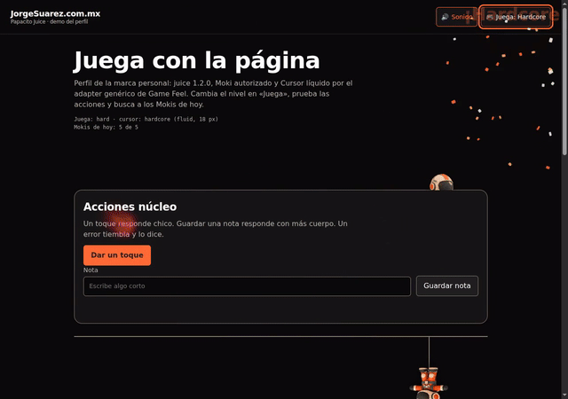
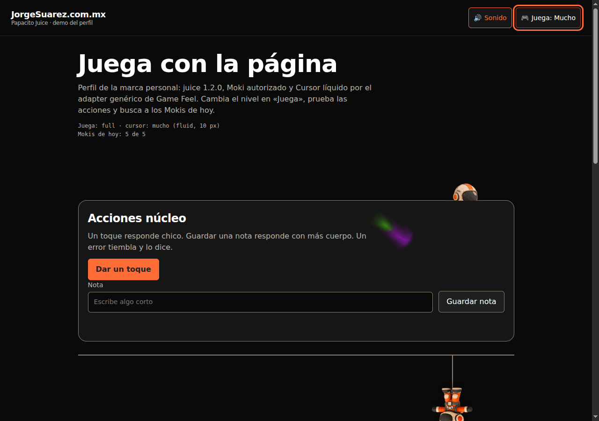
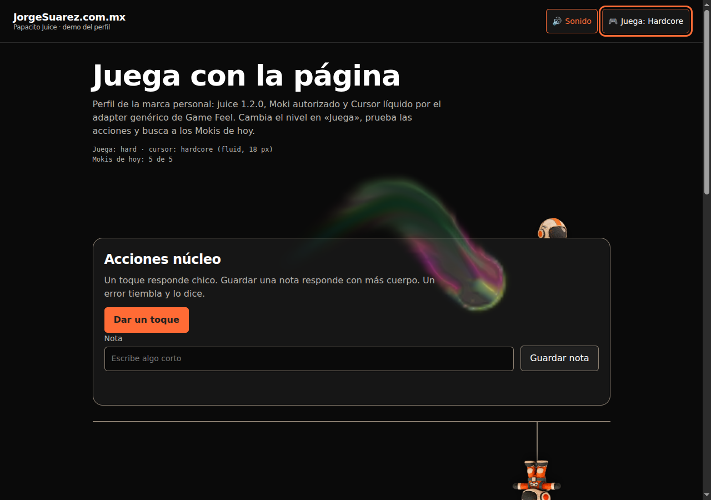
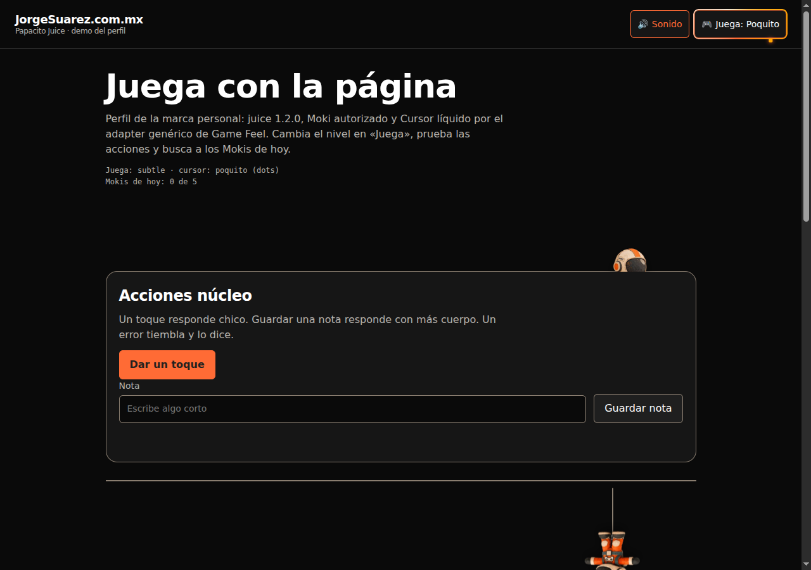

<div align="center">

<a href="https://jorgesuarez.com.mx"></a>

<br />

<a href="./README.md"></a>


<br />

**[▶ Verlo en vivo en jorgesuarez.com.mx](https://jorgesuarez.com.mx)** · Más proyectos en [github.com/jorgefsb](https://github.com/jorgefsb)

</div>

---

<p align="center"></p>
<p align="center"><sub>Grabación real de <code>examples/</code>, con eventos reales del puntero. Chromium con WebGL por software. <a href="docs/media/demo.mp4">Ver el video MP4</a></sub></p>

## ¿Qué es?

El perfil de [Game Feel](https://github.com/jorgefsb/game-feel) de la marca personal de Jorge Suárez. Coordina microinteracciones, sonido, Moki y [Cursor líquido](https://github.com/jorgefsb/cursor-liquido) desde el menú «Juega».

## ¿Para quién es?

Para los sitios de la marca personal de Jorge y para quien mantiene esos sitios. También sirve de ejemplo si quieres ver cómo se arma un perfil de marca encima de Game Feel.

Si lo quieres en tu propio sitio, usa Game Feel. Moki no se licencia.

## ¿Qué dolor resuelve?

Cada sitio de la marca tiene que sentirse igual: los mismos niveles, el mismo sonido, el mismo Moki. Copiar piezas sueltas de un sitio a otro termina en versiones distintas que ya nadie puede comparar.

## La propuesta

Un solo paquete, con versiones fijadas y verificadas por hash, que cualquier sitio de la marca instala igual.

- Exige a Moki real: comprueba sus 12 poses y, si falta algo, no se monta.
- Moki se queda quieto en Nada y conserva sus escondidas diarias.
- Hardcore se desbloquea al encontrar a los Mokis del día.
- El perfil nunca escribe por su cuenta el nivel, el sonido ni el desbloqueo: eso lo decide la persona.

| Poquito | Mucho | Hardcore | Moki |
|---|---|---|---|
|  |  |  |  |

## ¿Cómo se usa?

Como visitante: abre «Juega» en cualquier sitio de la marca y elige Nada, Poquito o Mucho. Busca a Moki en los bordes.

Como quien integra, con Node.js 20 o posterior:

```sh
npm ci
npm run setup
npm run demo
```

Y en la página:

```js
await PapacitoJuice.mount({ page: 'page' })
```

El orden de scripts y las opciones están en [docs/integration.md](./docs/integration.md).

## ¿Cuándo conviene y cuándo no?

Conviene solo en sitios de la marca personal de Jorge.

No va en sitios de Amber, Arden, Sparkplug o TecniMoto, ni en documentos formales, legales o páginas de pago. Así lo marca el [BrandKit](https://brandkit.jorgesuarez.com.mx/#juega).

## ¿Dónde lo pruebo?

En vivo: **[jorgesuarez.com.mx](https://jorgesuarez.com.mx)** y **[brandkit.jorgesuarez.com.mx](https://brandkit.jorgesuarez.com.mx/#juega)**.

## Hasta dónde llegamos

Versión 1.0.1. Trabaja sobre juice 1.2.0, Cursor líquido 1.0.1 y Game Feel 1.0.1, todos verificados contra sus hashes.

Mismo límite que Game Feel: en WebGL por software el motor puede bajar la calidad o pausarse, y no se probó en teléfonos físicos.

## Para quien construye

```sh
npm run verify
npm test
npm run test:browser
```

Versiones, garantías, arquitectura y principios: [guía técnica](./docs/GUIA-TECNICA.md), [arquitectura](./docs/architecture.md) y [principios](./docs/design-principles.md).

## Licencia

Código e instrucciones: [MIT](./LICENSE). Moki, su arte y la marca personal no son MIT y no se concede permiso de reutilización. Los archivos de Moki no vienen en este repo. Ver [NOTICES](./NOTICES).

---

<div align="center">

<sub>Hecho con amor ❤️🎮 por <a href="https://jorgesuarez.com.mx">JorgeSuarez.com.mx</a> · <a href="https://github.com/jorgefsb">Más proyectos</a> · <a href="./README.md">Read in English</a><br />Documentación actualizada el 10 nov 2026.</sub>

</div>
