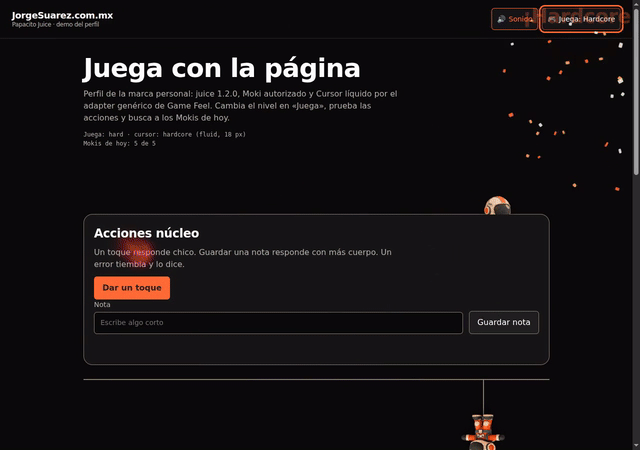
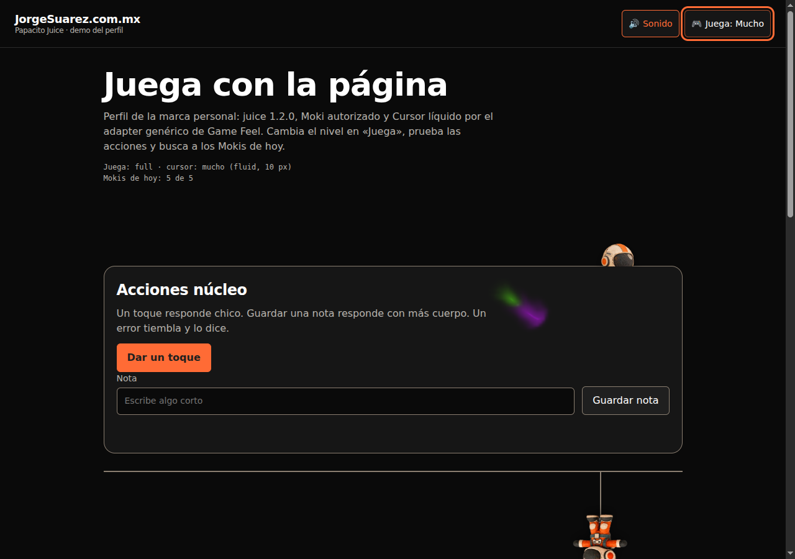
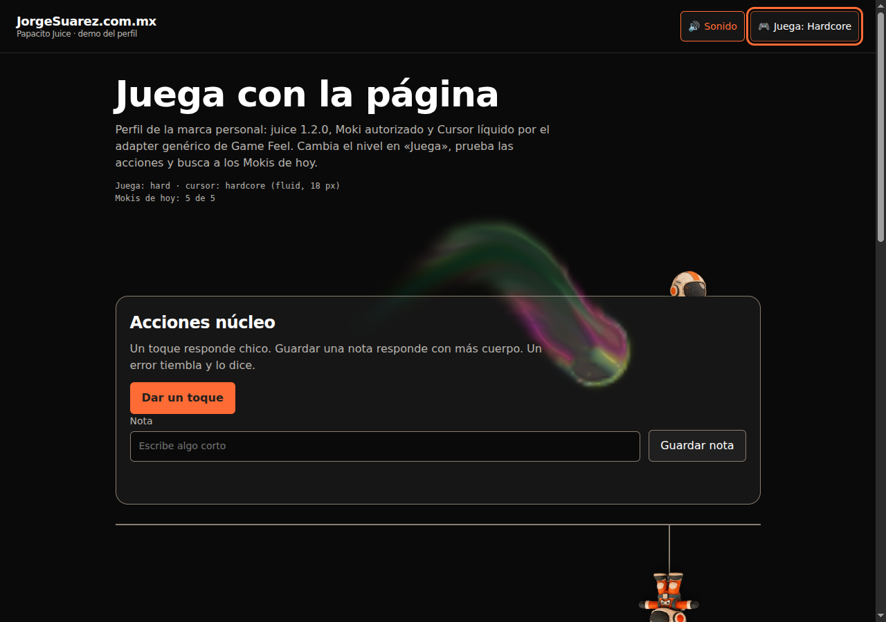
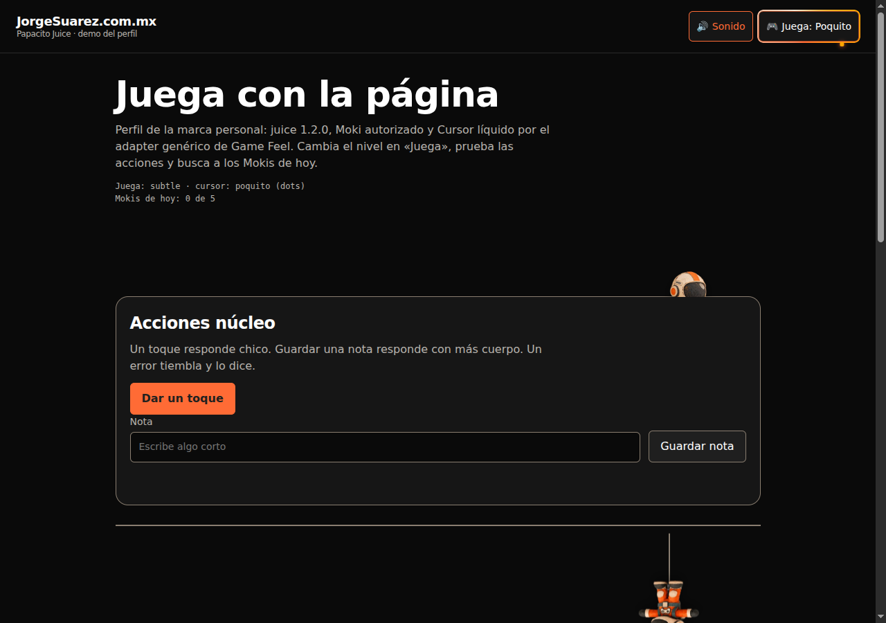

<div align="center">

<a href="https://jorgesuarez.com.mx"></a>

<br />


<a href="./README.es.md"></a>

<br />

**[▶ See it live at jorgesuarez.com.mx](https://jorgesuarez.com.mx)** · More projects at [github.com/jorgefsb](https://github.com/jorgefsb)

</div>

---

<p align="center"></p>
<p align="center"><sub>Real recording of <code>examples/</code>, with real pointer events. Chromium with software WebGL. <a href="docs/media/demo.mp4">Watch the MP4 video</a></sub></p>

## What is it?

The [Game Feel](https://github.com/jorgefsb/game-feel) profile of Jorge Suárez's personal brand. It coordinates microinteractions, sound, Moki and [Cursor líquido](https://github.com/jorgefsb/cursor-liquido) from the «Juega» menu.

## Who is it for?

For the sites of Jorge's personal brand and the people who maintain them. It also works as an example if you want to see how a brand profile is built on top of Game Feel.

If you want this on your own site, use Game Feel. Moki is not licensed.

## What pain does it solve?

Every site of the brand has to feel the same: the same levels, the same sound, the same Moki. Copying loose pieces from one site to another ends in different versions nobody can compare anymore.

## The proposal

One package, with pinned versions verified by hash, that every site of the brand installs the same way.

- It requires the real Moki: it checks his 12 poses and refuses to mount if anything is missing.
- Moki stays still on Nada and keeps his daily hiding spots.
- Hardcore unlocks when you find the Mokis of the day.
- The profile never writes the level, the sound or the unlock by itself: the person decides that.

| Poquito | Mucho | Hardcore | Moki |
|---|---|---|---|
|  |  |  |  |

## How do I use it?

As a visitor: open «Juega» on any site of the brand and choose Nada, Poquito or Mucho. Look for Moki at the edges.

As an integrator, with Node.js 20 or later:

```sh
npm ci
npm run setup
npm run demo
```

And on the page:

```js
await PapacitoJuice.mount({ page: 'page' })
```

Script order and options are in [docs/integration.md](./docs/integration.md) (in Spanish).

## When it fits and when it doesn't

It fits only on sites of Jorge's personal brand.

It does not go on Amber, Arden, Sparkplug or TecniMoto sites, or on formal documents, legal pages or payment pages. The [BrandKit](https://brandkit.jorgesuarez.com.mx/#juega) says so.

## Where can I try it?

Live: **[jorgesuarez.com.mx](https://jorgesuarez.com.mx)** and **[brandkit.jorgesuarez.com.mx](https://brandkit.jorgesuarez.com.mx/#juega)**.

## How far we got

Version 1.0.1. It runs on juice 1.2.0, Cursor líquido 1.0.1 and Game Feel 1.0.1, all verified against their hashes.

Same limit as Game Feel: on software WebGL the engine may lower quality or pause, and it was not tested on physical phones.

## For builders

```sh
npm run verify
npm test
npm run test:browser
```

Versions, guarantees, architecture and principles, in Spanish: [technical guide](./docs/GUIA-TECNICA.md), [architecture](./docs/architecture.md) and [principles](./docs/design-principles.md).

## License

Code and instructions: [MIT](./LICENSE). Moki, his art and the personal brand are not MIT and no reuse permission is granted. Moki's files do not ship in this repo. See [NOTICES](./NOTICES).

---

<div align="center">

<sub>Made with love ❤️🎮 by <a href="https://jorgesuarez.com.mx">JorgeSuarez.com.mx</a> · <a href="https://github.com/jorgefsb">More projects</a> · <a href="./README.es.md">Leer en español</a><br />Documentation updated on 10 Nov 2026.</sub>

</div>
