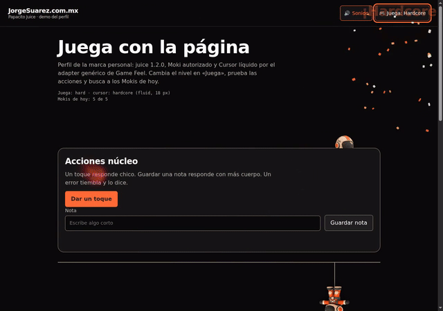

# Papacito Juice 1.0.1

Perfil de la marca personal de Jorge Suárez: microinteracciones, sonido, Moki y Cursor líquido coordinados desde el menú «Juega». Siempre incluye Moki real; sin él, usa Game Feel genérico.

[Repositorio](https://github.com/jorgefsb/papacito-juice) · [Versión 1.0.1](https://github.com/jorgefsb/papacito-juice/releases/tag/v1.0.1) · [Cursor líquido 1.0.1](https://github.com/jorgefsb/cursor-liquido/releases/tag/v1.0.1)



[Ver el video MP4](docs/media/demo.mp4). Capturas y grabación de [examples/](examples/index.html), con eventos reales del puntero y sin tinta simulada. Chromium con WebGL por SwiftShader; no es una prueba en un teléfono físico.

## Qué hace

Al tocar, escribir o guardar, la página responde con movimiento y sonido según el nivel elegido. Cursor líquido añade la estela del puntero. El adaptador evita que la estela vieja de Hardcore se dibuje encima: conserva las celebraciones y no bloquea clics, escritura ni scroll. El puntero nativo permanece visible.

| Juega | Valor | Respuesta del cursor |
|---|---|---|
| Nada | `off` | Sin efecto; reduced motion fuerza este nivel |
| Poquito | `subtle` | Puntos originales de 7 px, sin WebGL |
| Mucho | `full` | Fluido con radio de 10 px CSS |
| Hardcore | `hard` | Fluido con radio de 18 px CSS |

No hay quinto nivel estable. El visitante conserva su elección de sonido y nivel.

### Poquito


### Mucho


### Hardcore


### Moki real


`PapacitoJuice.mount()` exige Moki 1.2.0 y comprueba sus 12 poses. Si falta el script, los escondites o el arte, rechaza la instalación sin montar el cursor. Moki queda quieto en Nada y conserva sus escondidas diarias. Hardcore se desbloquea al encontrar los Mokis del día.

## Instalar y probar

Requiere Node.js 20 o posterior. No hay paquete publicado en npm.

```sh
npm ci
npm run setup
npm run verify
npm run demo
npm test
npm run test:browser
```

Abre la dirección que imprime el servidor y entra a `/examples/`. `setup` descarga las dependencias de fuentes versionadas y verifica sus SHA-256 antes de escribir `vendor/`. No necesita opciones locales. Para ejecutar Chromium instala su navegador con `npx playwright install chromium`.

Para una comprobación sin descargar releases puedes usar `npm run setup -- --cursor-dir ruta/a/cursor-liquido/dist --game-feel-dir ruta/a/game-feel`. Solo se acepta el `dist` estable 1.0.1 con manifest, JS y CSS exactos. No existe un fallback que empaquete fuentes antiguas. `--juice-dir` permite una copia local del mismo núcleo verificado.

## Versiones y garantías

- **Papacito Juice 1.0.1** es la versión de este perfil.
- **juice 1.2.0** es otro paquete: permanece byte por byte en el commit `f1b3b9c77a43ffbcbd331bb88420a436614fdbc3` de [game-industry-resources](https://github.com/jorgefsb/game-industry-resources/tree/f1b3b9c77a43ffbcbd331bb88420a436614fdbc3/juice/1.2.0).
- **Cursor líquido 1.0.1 estable** conserva renderer y adaptador aprobados. Incluye el guard externo que preserva input pendiente cuando baja la calidad, sin cambiar shaders, color ni presupuesto de cuadros.
- **Game Feel 1.0.1** se descarga del tag versionado y se verifica con los hashes del adaptador genérico. Los 20 archivos de juice, incluyendo Moki, se verifican contra el manifest upstream.

Los hashes completos están en [scripts/setup-demo.mjs](scripts/setup-demo.mjs). `verify` comprueba los archivos en disco contra pins propios, no solo contra un informe generado. El bundle se valida completo y también por renderer, adapter, guard y wrapper.

## Integrar en otra página

Sirve desde tu propio origen juice 1.2.0 completo, Cursor líquido 1.0.1, Game Feel 1.0.1 y `src/papacito-juice.{js,css}`. Configura `<html data-jz-sound="on">`, los escondites `[data-moki]` y llama `await PapacitoJuice.mount({ page: 'page' })`. Para la home añade `data-jz-default="full"` y usa `{ page: 'home' }`. El perfil nunca escribe el nivel, sonido o desbloqueo por su cuenta.

Orden de scripts, API, opciones y rollback en [Integración](docs/integration.md). También: [Arquitectura](docs/architecture.md), [Principios](docs/design-principles.md), [Licencia y privacidad](docs/privacy-license.md).

## Verificación y límites

Los resultados reales viven en [reports/browser-report.json](reports/browser-report.json) y [reports/media-report.json](reports/media-report.json). La suite cubre niveles, controles, desmontaje, móvil emulado, reduced motion y preferencias. Las capturas de QA quedan en `qa/`, ignorado por Git.

En SwiftShader el motor puede reducir calidad o pausarse si supera su presupuesto; ese límite sigue activo. La estela vieja de Hardcore se oculta mediante CSS, pero juice sigue creando sus nodos. El fluido se mezcla con `screen` y se aprecia mejor en fondo oscuro.

## Licencia

Código e instrucciones: [MIT](LICENSE). Moki, su arte y la marca personal **no son MIT**: no se concede permiso de reutilización. Las capturas y el video muestran la integración autorizada de la marca personal; no son un paquete de assets. Los WEBP de Moki no se incluyen en este repositorio. Las dependencias descargadas permanecen en `vendor/`, ignorado por Git. Ver [NOTICES](NOTICES).
